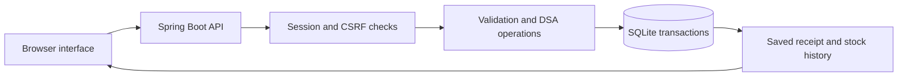

# MarketDesk

A full-stack supermarket workspace for inventory, simulated cash checkout, and order fulfillment. A Java API validates every change and saves products, receipts, and stock movements in SQLite. The responsive browser interface runs on the same local server.

**Stack:** Java 17 · Spring Boot · Spring Security · JDBC · SQLite · HTML · CSS · JavaScript

[Quick start](#quick-start) · [Walkthrough](docs/WALKTHROUGH.md) · [API and configuration](backend/README.md) · [Security](SECURITY.md)

## What you can do

- Search and filter products by name, SKU, category, availability, or low stock.
- Add and edit products, archive them without deleting receipt history, and adjust stock with a recorded reason.
- Build a basket, enter fictional cash, and view a receipt with exact totals and change in PKR.
- Fulfill the oldest pending order with a FIFO queue or cancel the newest pending order with a LIFO stack.
- Review sales summaries, category counts, popular products, and low-stock warnings.
- Keep inventory and order history across application restarts.

The initial eight products are fictional. Cash values are simulated bookkeeping; the application does not connect to a payment gateway, bank, or real supermarket.

## Quick start

Install **JDK 17 or 21** and **Maven 3.9 or newer**. JDK 17 is the verified runtime. Node.js is optional and is only needed for frontend tests.

On Windows, double-click [launcher/Start MarketDesk.cmd](launcher/Start%20MarketDesk.cmd). The launcher checks Java and Maven, builds the backend, starts the application, and opens the browser. Keep its terminal open while using MarketDesk; Ctrl+C stops the server it started.

Open [http://127.0.0.1:8081/](http://127.0.0.1:8081/).

| Local demo username | Password |
| --- | --- |
| `admin` | `DemoPass123!` |

Choose **Fill demo account**, then **Sign in**. The form never submits automatically.

### Manual start

From the project root:

```sh
cd backend
mvn --batch-mode verify
java -jar target/marketdesk-1.0.0.jar
```

The API serves the sibling `frontend/` directory; no separate frontend development server or build step is required. The interface uses local styles, scripts, and SVG icons.

## Try a complete workflow

1. Sign in and inspect the overview's products, units, and low-stock list.
2. Open **Checkout**, add a product, adjust its quantity, and enter enough simulated cash.
3. Choose **Complete checkout**, inspect the receipt, then open **Orders**.
4. Complete a second sale. Fulfill the oldest pending order and cancel the latest pending order; cancellation restores its stock.
5. Open **Inventory**, add a fictional product, edit its price, and record a stock correction with a reason.
6. Stop and restart the application. Sign in again to confirm that the records remain.

See the [short walkthrough](docs/WALKTHROUGH.md) for expected results and safe retry behavior.

## Where the DSA concepts appear

| Structure | Actual use |
| --- | --- |
| `ArrayList` | Product and cart working sets; sorted canonical cart IDs for retry comparison |
| `HashMap` | Rejecting duplicate products in checkout requests with direct key lookup |
| `ArrayDeque` as a queue | FIFO fulfillment of the oldest persisted pending order |
| `ArrayDeque` as a stack | LIFO cancellation of the newest persisted pending order |

The pending deque is rebuilt from ordered SQLite IDs before each operation. Restarting the server therefore preserves queue order. The database remains authoritative for prices, stock, and status changes.



## Reliability and storage

- Prices and totals use integer paisa: `12550` represents PKR 125.50. The server calculates receipt totals from current product prices.
- Checkout reserves stock, creates the order, and records stock movements in a single transaction. Insufficient stock or cash rolls back the entire operation.
- Each checkout has a UUID request ID. An explicit retry of the same basket returns the original order, and a changed basket with the same ID is rejected.
- If a checkout response is lost, the browser retains its request and locks the basket. **Retry same checkout** recovers the result without starting another sale.
- Other uncertain changes require refreshing and reviewing the records before another write. The client never automatically repeats a mutation after a connection or CSRF failure.
- Receipts retain their original product names and prices. Later product edits do not rewrite past receipts.

The default database is `backend/data/marketdesk.sqlite` when launched as documented. Database files, environment files, build output, and dependencies are ignored by Git. Startup seeds an empty schema once and does not reset saved records.

For a backup, stop the application and copy the database together with any SQLite WAL companion files, or use SQLite's backup API. Keep backups outside the repository. See the [backend guide](backend/README.md) for environment overrides and schema limits.

## Verify the project

Run from the project root:

```sh
mvn --batch-mode -f backend/pom.xml verify
node --check frontend/app.js
npm ci --prefix frontend --ignore-scripts
npm test --prefix frontend
```

Use Node.js 24 or newer for the DOM tests. Backend integration checks cover authenticated HTTP requests, CSRF, exact money, stock rollback, duplicate and concurrent checkout, FIFO/LIFO operations, and a real restart against the same SQLite file. Frontend tests exercise sign-in, checkout and recovery, product and stock forms, queue controls, search, and escaped record content. Tests use isolated fixtures and temporary databases.

## Folder layout

```text
project/
├── backend/       # Java API, SQLite schema initialization, integration tests
├── frontend/      # Browser interface, local assets, DOM regression tests
├── launcher/      # Windows startup helper and CMD entry point
├── docs/          # Walkthrough and project notes
└── POSSystem.java # Preserved original empty coursework file; not a runtime entry point
```

## Security and demo limits

The API uses server-side session authentication, BCrypt password hashing, CSRF checks, parameterized database queries, input validation, and restrictive browser response headers. It binds to loopback by default. Public source access does not make application data public.

The published demo credential is for fictional local data. Before shared hosting, configure a unique `MARKETDESK_PASSWORD`, HTTPS and secure cookies, account administration, rate limiting, monitoring, and backups. This coursework application does not implement multi-user roles, refunds, tax accounting, external payment processing, or production operational controls. See [SECURITY.md](SECURITY.md) for vulnerability reporting.

## Troubleshooting

- **Port occupied:** run `powershell -NoProfile -ExecutionPolicy Bypass -File launcher/start-local.ps1 -Port 8087` from the project root and use the URL it prints.
- **Java configuration:** ensure `javac -version` identifies the intended JDK. The launcher checks valid JDK candidates instead of trusting a stale `JAVA_HOME`.
- **Server connection lost:** keep the launcher terminal open, then use **Refresh workspace** once the server is available. Review saved records before repeating a change.
- **Unknown checkout result:** keep the original tab and choose **Retry same checkout**. Do not create a fresh sale to compensate for a missing response.
- **Missing interface during manual start:** run Java from `backend/`, or set `MARKETDESK_FRONTEND` to the absolute `frontend` directory.

Original application code is distributed under the repository's [license](LICENSE). Existing third-party dependencies retain their own terms.
